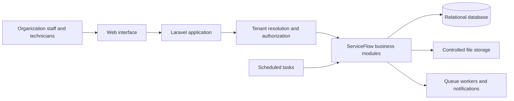

# ServiceFlow

ServiceFlow is a planned field service and maintenance management platform for businesses that coordinate customer requests, equipment, technicians, and on-site work. It is intended for AC and refrigeration maintenance companies, electrical and equipment repair businesses, field service providers, and small and medium-sized maintenance companies.

## Project status

**Early scaffold; product features are not yet implemented.** The repository currently contains a Laravel starter application with a welcome page, a basic user model, framework database migrations, and example tests. It does not yet provide ServiceFlow business workflows or a production SaaS dashboard.

This README distinguishes the starter implementation from the planned product. Roadmap items below are plans, not existing functionality.

## Key objectives

- Bring customer, asset, request, and work-order information into one operational system.
- Help dispatchers plan technician workloads and help technicians complete work in the field.
- Support secure organization-level data isolation for a multi-tenant SaaS product.
- Provide a foundation that can grow from small maintenance teams to multi-branch businesses.
- Keep business-critical actions auditable, validated, authorized, and testable.

## Features: implemented vs. planned

| Area | Current implementation | Planned capability |
| --- | --- | --- |
| Application foundation | Laravel 13 starter application, one welcome route/view, a `User` model, and Laravel framework configuration | ServiceFlow application and operations dashboard |
| Authentication | Laravel's web guard and password-reset configuration are present; no login, logout, or reset screens/routes are currently defined | Login, logout, password reset, organization membership, and access control |
| Persistence | Starter migrations for users, password resets, sessions, cache, and queues | Organization and field-service data models |
| Frontend | Vite, Tailwind CSS, and Livewire dependencies are installed | ServiceFlow dashboard and mobile-friendly technician workflows |
| Tests | Example feature and unit tests | Automated coverage for critical business and tenant-isolation workflows |
| Product modules | None of the ServiceFlow modules below are implemented | Modules described in [Main modules](#main-modules) |

## Technology stack

Versions below reflect the installed dependency set observed in this repository. The PHP constraint is from `composer.json`; the runtime version is the one available during repository inspection.

| Technology | Current repository state |
| --- | --- |
| PHP | `^8.3` required; PHP 8.4.12 runtime observed |
| Laravel | 13.38.0 |
| Livewire | 4.4.8 |
| Livewire Blaze | 1.0.19 |
| Frontend | Tailwind CSS 4.3.3, Vite 8.3.5, Laravel Vite Plugin 3.2.0, and Vite Plus 0.3.0 |
| Database | SQLite is the `.env.example` default; MySQL and MariaDB connections are configured in Laravel |
| Testing and quality | Pest 5.3.3, Pest Laravel Plugin 5.0.1, Laravel Pint 1.32.1, and Larastan 3.13.1 |

Local Node.js 22.12.0 and npm 10.9.0 were observed. Use a Node/npm version compatible with the installed Vite toolchain.

The following are **not installed as direct project dependencies** and should be considered only if a later phase requires them:

- FilamentPHP administration panel
- Laravel Sanctum API authentication
- Laravel Reverb broadcasting
- A dedicated tenancy or role-permission package

Redis connection settings and Laravel queue/cache drivers are available in the starter configuration, but a Redis service is not established by this repository. Laravel's database queue and cache are configured as the `.env.example` defaults.

## Architecture overview

The diagram represents the **intended architecture**, not deployed or implemented product components. Tenant resolution, authorization, domain services, and production infrastructure still need to be designed and built.



The planned application should centralize organization context and authorization, keep tenant-owned data scoped to the active organization, and use database transactions for critical multi-step operations. Infrastructure choices beyond the currently configured starter defaults remain open decisions.

## Main modules

All modules in this section are **planned**.

1. **Organization and multi-tenancy**
   - Organization onboarding, company profiles, branches, and organization-level settings.
   - Secure organization-level data isolation and centralized tenant resolution.
2. **Authentication and access control**
   - Login, logout, password reset, and organization membership.
   - Role-based permissions and authorization policies.
3. **Customer management**
   - Customer profiles and contacts, multiple service addresses, and customer service history.
4. **Equipment and asset management**
   - Equipment details, serial numbers, warranty information, ownership, and location.
   - Maintenance and repair history.
5. **Service requests**
   - Request creation, priority, status, assignment, and conversion to work orders.
   - Attachments, comments, and activity history.
6. **Work order management**
   - Work order creation, assignment, technician scheduling, and job status tracking.
   - Work logs, labour, used parts, photos, and completion reports.
7. **Technician management**
   - Technician profiles, availability, workload, and assignment tracking.
   - A mobile-friendly job interface.
8. **Preventive maintenance**
   - Maintenance contracts, service intervals, and upcoming maintenance schedules.
   - Automatic recurring work-order generation and contract renewal reminders.
9. **Estimates, invoices, and payments**
   - Estimates and customer approvals, invoice generation, payment records, and outstanding balances.
   - Tax handling appropriate to the configured market.
10. **Notifications and reporting**
    - Email and configurable notification channels.
    - Overdue-job and upcoming-maintenance alerts, operational dashboards, and reports.
11. **SaaS subscription management**
    - Subscription plans, feature limits, organization billing, usage tracking, and subscription lifecycle management.

## Dashboard UI direction

The dashboard is a **design direction only**; the current application does not include this dashboard. The planned interface should have:

- A dark navy sidebar with ServiceFlow branding and a light workspace with white cards.
- Blue primary actions and restrained status colors.
- Search, notifications, a user profile, and an organization switcher.
- KPI cards for open requests, active work orders, scheduled jobs, completed jobs, and pending payments.
- Service-request trends, work-order status charts, technician utilization, and today's schedule.
- Recent service requests and upcoming maintenance tables.

## User roles and permissions

Roles and permissions are **not implemented**. The following are initial product roles to validate during Phase 1; the final permission model should be based on organization workflows:

| Planned role | Intended responsibility |
| --- | --- |
| Organization administrator | Manage organization settings, members, branches, and access |
| Dispatcher | Triage requests, assign work, and coordinate schedules |
| Technician | View assigned work and record job progress and completion |
| Office or billing staff | Maintain customer records and manage estimates, invoices, or payments |

Authorization should be enforced server-side through policies and organization membership, not only by hiding interface actions.

## Installation prerequisites

- PHP satisfying the repository's `^8.3` Composer requirement, with the extensions required by Laravel and the selected database driver.
- Composer.
- Node.js and npm compatible with the installed Vite toolchain.
- SQLite for the default local setup, or a reachable MySQL/MariaDB instance if using that configured connection.
- Redis only if you choose to use Redis-backed queues, cache, or other services; it is not required by the default `.env.example`.

## Local development setup

The following PowerShell commands use the repository's default SQLite configuration. `composer setup` is an existing project script that installs Composer and npm dependencies, creates `.env` if missing, generates an application key, runs migrations, and builds frontend assets.

```powershell
composer setup
composer run dev
```

`composer run dev` invokes the project's Artisan `dev` command. Alternatively, run the web server and Vite separately in two terminals:

```powershell
php artisan serve
```

```powershell
npm run dev
```

For a manual setup, useful when configuring MySQL before the first migration:

```powershell
composer install
if (!(Test-Path .env)) { Copy-Item .env.example .env }
php artisan key:generate
# Configure .env for the selected database before continuing.
php artisan migrate
npm install
npm run build
```

Generate `APP_KEY` for a new local environment only. Do not replace an existing key for an environment containing encrypted application data.

## Environment configuration

`.env.example` is the checked-in configuration template. Keep credentials and secrets in the untracked local `.env` or in your deployment platform's secret manager; do not commit them. Never copy real credentials into documentation or source control.

The template currently defaults to SQLite, database-backed sessions, database-backed cache, database-backed queues, and log-based mail. For a local MySQL setup, create an empty database and set the corresponding values in `.env` before migrating:

```dotenv
APP_NAME=ServiceFlow
APP_ENV=local
APP_DEBUG=true
APP_URL=http://localhost:8000

DB_CONNECTION=mysql
DB_HOST=127.0.0.1
DB_PORT=3306
DB_DATABASE=<local_database_name>
DB_USERNAME=<local_database_user>
DB_PASSWORD=<local_database_password>
```

Keep `APP_KEY` generated by `php artisan key:generate`. Configure production values, mail transport, storage, queue/cache backend, and debug settings independently for each environment. Do not use `APP_DEBUG=true` in production.

## Database setup and migrations

The configured default is SQLite at `database/database.sqlite`. The starter migrations create framework tables for users, password-reset tokens, sessions, cache, and queued jobs; they do **not** create ServiceFlow business entities.

After configuring the database:

```powershell
php artisan migrate
php artisan migrate:status
```

The `DatabaseSeeder` currently creates a starter test user. Review and replace development seed data as product onboarding is designed; no ServiceFlow seed data is currently provided.

## Running the application and frontend assets

Frontend entry points are `resources/css/app.css` and `resources/js/app.js`. Tailwind CSS is integrated through Vite. Use:

```powershell
npm run dev
```

for local asset development, or:

```powershell
npm run build
```

to build assets. The current only application page is the Laravel welcome route.

## Queues, scheduled tasks, and tests

The `.env.example` configures the database queue. The starter includes the queue tables, but it has no ServiceFlow jobs or notifications yet. To run a worker when queue jobs are added:

```powershell
php artisan queue:work
```

Laravel's scheduler is available, but no project-specific scheduled tasks are currently defined. When scheduled work is introduced, run it locally with:

```powershell
php artisan schedule:work
```

Run the existing tests with:

```powershell
php artisan test
```

The current tests are framework starter examples, not coverage of ServiceFlow workflows. The Composer `test` script additionally runs the configured Pint check and Larastan analysis before the Artisan test suite.

## Security and multi-tenancy principles

These are planned engineering principles; they are not evidence that tenant isolation or production controls are already implemented.

- Resolve the active organization centrally and authorize each action against its membership and role.
- Scope every organization-owned query and mutation to the authorized tenant; test cross-tenant access boundaries.
- Validate input and enforce authorization on the server for every state-changing operation.
- Use database transactions for critical business operations that update related records.
- Validate uploads, restrict file access, and avoid publicly exposing private customer or job attachments.
- Queue notifications with retry and failure handling where appropriate.
- Record audit trails for important business actions.
- Add automated tests for tenant boundaries and critical customer, request, work-order, and billing workflows.
- Keep configuration environment-based, secrets out of source control, and production debug output disabled.
- Plan structured logging, backups, monitoring, and deployment/recovery procedures before production use.
- Choose tenancy, authorization, API, and real-time packages only after validating requirements; no dedicated tenancy package is currently installed or selected.

## Development roadmap

All phases below are **planned**. The existing Laravel scaffold is a starting point, not completion of Phase 1.

| Phase | Planned scope | Status |
| --- | --- | --- |
| 1 | Laravel setup, authentication, organization onboarding, roles, tenant isolation, and base Filament dashboard | Planned; starter framework exists, product capabilities do not |
| 2 | Customers, service addresses, equipment, and assets | Planned |
| 3 | Service requests, work orders, assignments, and technician workflows | Planned |
| 4 | Scheduling, estimates, invoices, and payment records | Planned |
| 5 | Preventive maintenance, contracts, and recurring work orders | Planned |
| 6 | Notifications, reports, subscriptions, testing, security hardening, and production deployment | Planned |

## Contribution guidelines

Contributions should preserve the distinction between implemented functionality and roadmap intent. Before opening a change:

1. Review the existing Laravel and frontend conventions and keep changes focused.
2. Include or update automated tests for behavior changes, especially authorization and tenant isolation.
3. Run the relevant tests and quality checks (`composer test` for the configured full project checks).
4. Document new setup requirements and configuration without committing secrets.
5. Do not describe a planned capability as implemented until it is present and verified.

## License

The Composer project metadata declares the project as **MIT licensed**. A root `LICENSE` file is not currently present; add and maintain the appropriate license text before distributing the project.
