# ServiceFlow

ServiceFlow is a planned field service and maintenance management platform for businesses that coordinate customer requests, equipment, technicians, and on-site work. It is intended for AC and refrigeration maintenance companies, electrical and equipment repair businesses, field service providers, and small and medium-sized maintenance companies.

## Project status

**Early functional foundation; not production-ready SaaS.** The repository includes an organization-scoped Filament administration panel for core customer, service, scheduling, maintenance, and financial workflows, along with the organization, branch, membership, role, and panel-access foundation. Mobile technician workflows, member administration, notifications, and SaaS operations remain out of scope.

The implemented panel is an initial operations MVP, not a complete ServiceFlow product. Roadmap items below are plans unless explicitly marked as implemented.

## Key objectives

- Bring customer, asset, request, and work-order information into one operational system.
- Help dispatchers plan technician workloads and help technicians complete work in the field.
- Support secure organization-level data isolation for a multi-tenant SaaS product.
- Provide a foundation that can grow from small maintenance teams to multi-branch businesses.
- Keep business-critical actions auditable, validated, authorized, and testable.

## Features: implemented vs. planned

| Area | Current implementation | Planned capability |
| --- | --- | --- |
| Application foundation | Laravel 13 and a tenant-aware Filament admin panel with organization-slug routing | Full ServiceFlow application and production operations |
| Authentication and access control | Laravel web guard; organization memberships and role assignments; only platform admins and active organization owners/admins can access the panel; business resources are tenant-scoped | Member management, invitations, fine-grained policies, and mobile authentication |
| Persistence | Framework tables plus organizations, branches, memberships, customers, addresses, equipment, requests, work orders and entries, maintenance contracts, estimates, invoices, items, payments, and technician availability; composite constraints protect organization ownership and payment history | Subscription, notification, and audit-event data |
| Frontend | Filament dashboard with date/branch filters, database-backed KPIs and charts, scheduling, recent requests, upcoming maintenance, and availability-based utilization | Mobile technician workflows and visual customization beyond Filament defaults |
| API | No application API routes or token authentication are implemented | Authenticated, versioned REST API for authorized mobile clients |
| Tests | Feature coverage for role and tenant access, tenant resource pages and data isolation, invoice totals, payment recording and limits, work-order transitions, estimate conversion, and technician availability | Broader workflow, authorization, and production-database coverage |
| Product modules | Customer and equipment CRUD, service request conversion, work-order scheduling and status actions, maintenance contracts, estimate approval/invoice generation, marking invoices as sent, and payment recording | Recurring work-order generation, notifications, reports, and complete lifecycle workflows |

## Demo User Roles & Credentials

The seed data provisions pre-configured accounts across all supported user roles under the demo organization **ServiceFlow HQ** (`slug: serviceflow-hq`) and branch **Main Branch** (`code: MAIN`).

> **Default Password:** `12345678` for all seeded accounts.  
> **Sign In URL:** `http://localhost:8000/admin/login`  
> **Tenant Dashboard:** `http://localhost:8000/admin/serviceflow-hq`  
> **Technician Field Portal:** `http://localhost:8000/technician`

| Role | Name | Email Address | Password | Permissions & Primary Scope |
| --- | --- | --- | --- | --- |
| **Platform Administrator** | Super Administrator | `superadmin@example.com` | `12345678` | Global platform administration, cross-tenant management, System Settings (`Mail Settings`, `Branding & Logo`), and all operational modules. |
| **Organization Owner** | Organization Owner | `organization@example.com` | `12345678` | Complete organization ownership, branding settings, branch control, all operations and billing within ServiceFlow HQ. |
| **Organization Administrator** | Organization Administrator | `admin@example.com` | `12345678` | Full administrative control over staff, customers, service operations, dispatch, estimates, invoices, and payments. |
| **Service Dispatcher** | Service Dispatcher | `dispatcher@example.com` | `12345678` | Service request triage, work order scheduling, dispatching, and technician weekly availability planning. |
| **Service Manager** | Service Manager | `servicemanager@example.com` | `12345678` | Service operations oversight, maintenance contracts, work order approvals, equipment asset management. |
| **Service Manager (Alt)** | Service Manager (Alt) | `manager@example.com` | `12345678` | Alternate manager profile for multi-branch and multi-shift supervisory operations. |
| **Service Technician** | Service Technician | `technician@example.com` | `12345678` | Mobile Technician Workspace (`/technician`), active job execution, work logs, parts usage, and availability hours. |
| **Organization Accountant** | Organization Accountant | `accountant@example.com` | `12345678` | Financial records, estimates approval, customer invoicing, payment recording, and balance tracking. |

To seed or refresh these demo accounts at any time:
```powershell
php artisan db:seed --class=RoleUserSeeder
```

## Application Showcase & Screenshots

Below are captures of the implemented interfaces across ServiceFlow.

### 1. Sign In & Authentication
Clean, branded authentication portal with dynamic company logo and session persistence.
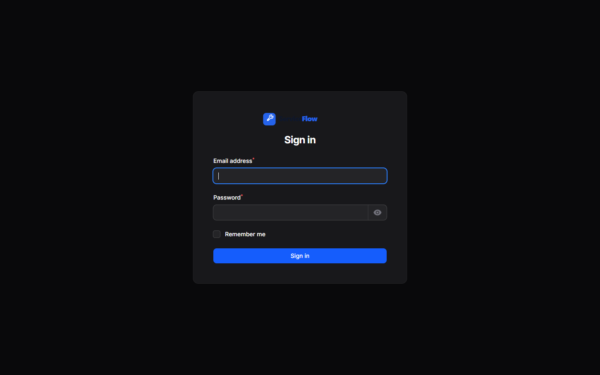

### 2. Operations & Executive KPI Dashboard
Centralized metrics dashboard with dynamic date and branch filtering, real-time KPI stat cards, revenue metrics, active work orders, and recent payment logs.
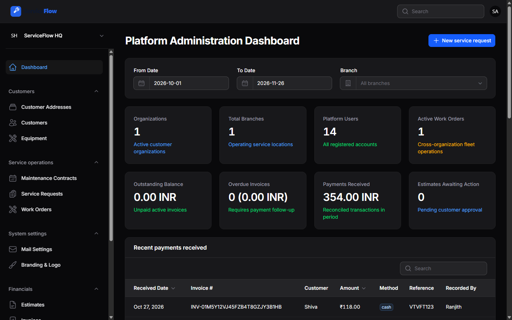

### 3. Work Order Management & Scheduling
Track work orders by priority, assigned technician, scheduled start times, and execution status (`New`, `Scheduled`, `In Progress`, `Completed`, `Cancelled`).
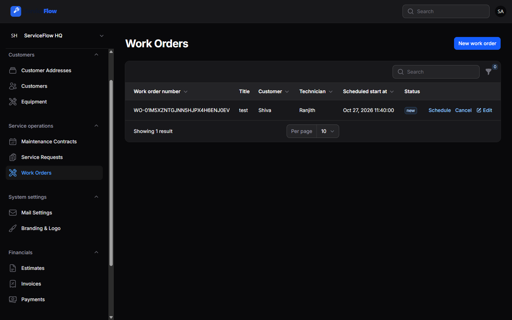

### 4. Service Requests Intake & Conversion
Customer issue logging with SLA priority flags, equipment tags, and one-click conversion into scheduled work orders.
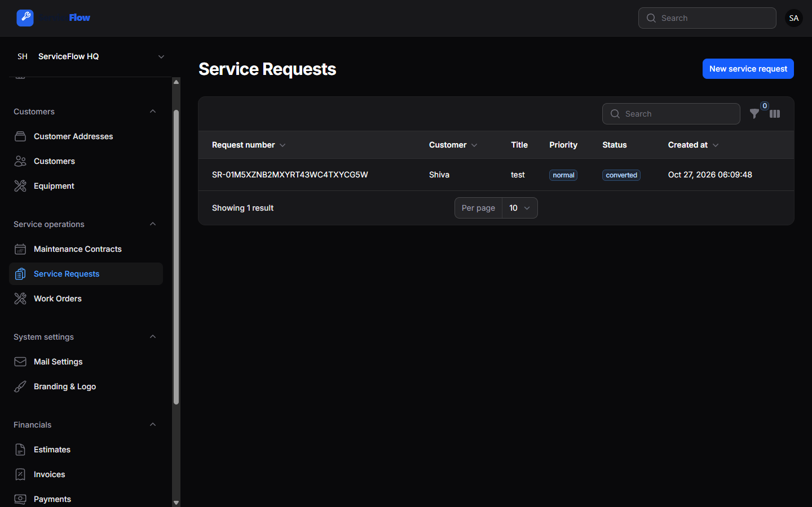

### 5. Customer Directory & Profiles
Tenant-scoped client registry with associated primary contacts, billing details, and multiple service addresses.
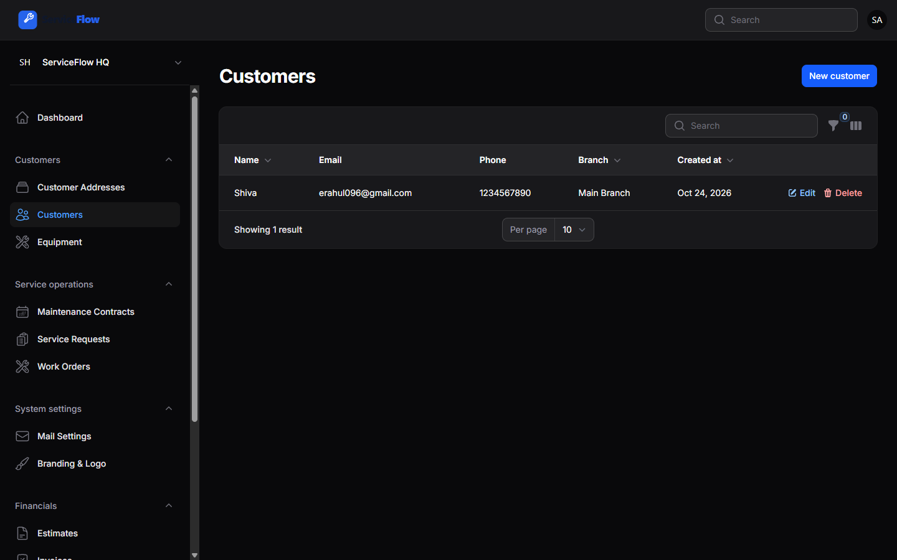

### 6. Equipment & Asset Tracking
Equipment database tracking serial numbers, model information, installation dates, active warranties, and linked customers.
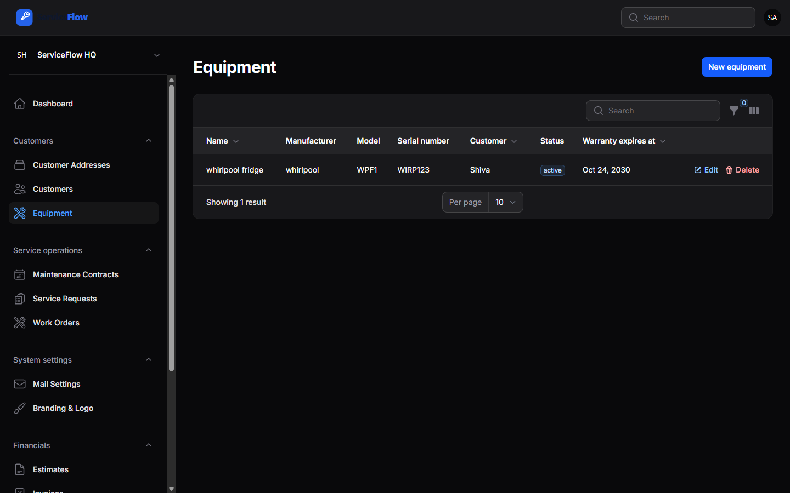

### 7. Preventive Maintenance Contracts
Recurring maintenance agreements, covered assets, inspection schedules, and automated service reminders.
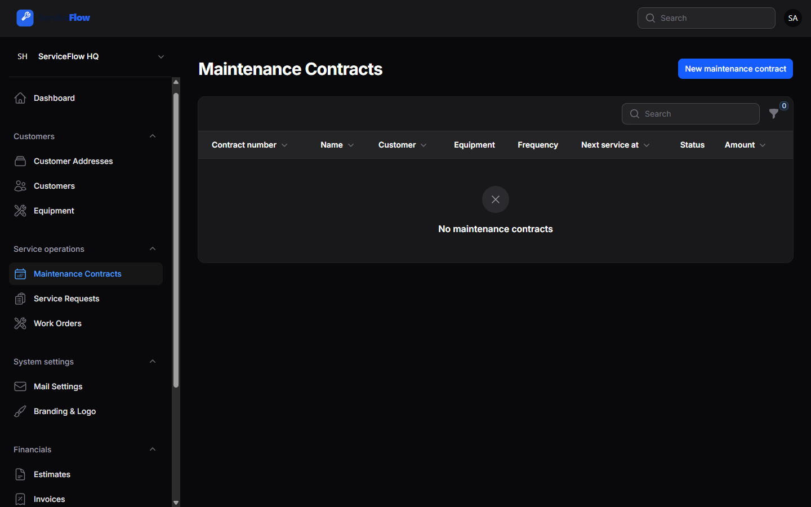

### 8. Invoicing, Billing & Payments
Commercial invoicing with line items, tax calculations, balance tracking, payment receipt recording, and PDF export status.
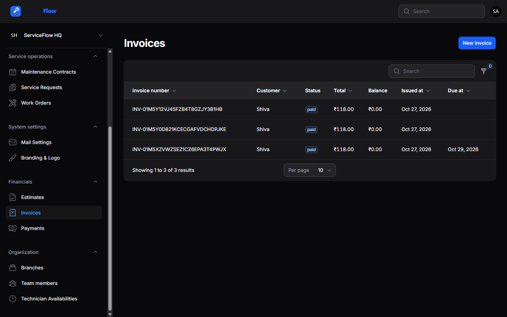

### 9. System Mail Settings
Platform administration tool under **System settings** to configure Gmail OAuth / App Passwords or Custom SMTP with live test email delivery.
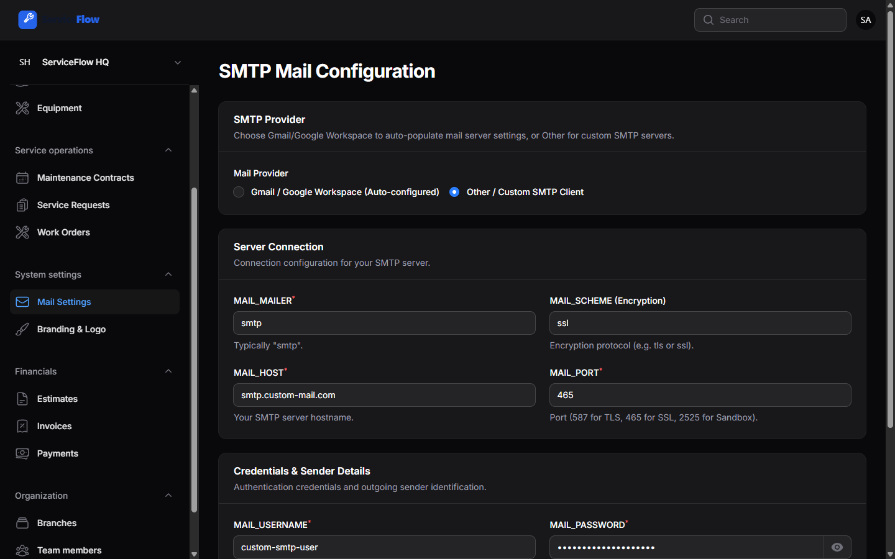

### 10. Branding, Logo & Visual Customization
Under **System settings** below Mail Settings: upload company logos, adjust display height, configure browser favicons, brand name, support emails, and choose portal accent color palettes.
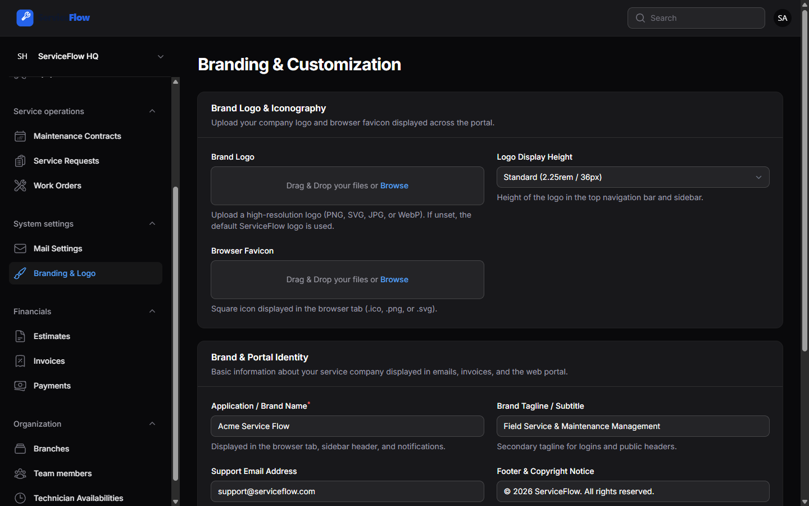

### 11. Technician Mobile Field Workspace
Dedicated field interface at `/technician` optimized for mobile technicians to track today's scheduled jobs, update task status, and log hours.
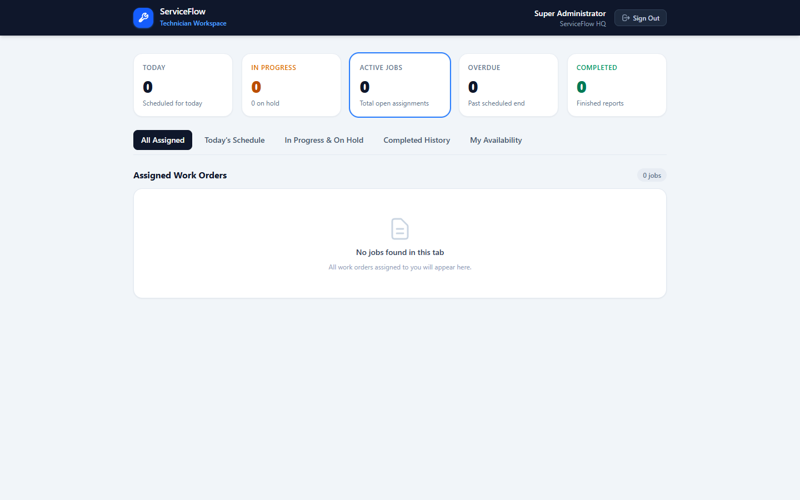

## Technology stack

Versions below reflect the installed dependency set observed in this repository. The PHP constraint is from `composer.json`; the runtime version is the one available during repository inspection.

| Technology | Current repository state |
| --- | --- |
| PHP | `^8.3` required; PHP 8.4.12 runtime observed |
| Laravel | 13.38.0 |
| Filament | 5.10.3 |
| Livewire | 4.4.8 |
| Livewire Blaze | 1.0.19 |
| Frontend | Tailwind CSS 4.3.3, Vite 8.3.5, Laravel Vite Plugin 3.2.0, and Vite Plus 0.3.0 |
| Database | SQLite is the `.env.example` default; MySQL and MariaDB connections are configured in Laravel |
| Testing and quality | Pest 5.3.3, Pest Laravel Plugin 5.0.1, Laravel Pint 1.32.1, and Larastan 3.13.1 |

Local Node.js 22.12.0 and npm 10.9.0 were observed. Use a Node/npm version compatible with the installed Vite toolchain.

The following are **not installed as direct project dependencies** and should be considered only if a later phase requires them:

- Laravel Sanctum API authentication
- Laravel Reverb broadcasting
- A dedicated role-permission package; the current foundation uses explicit role assignments

Redis connection settings and Laravel queue/cache drivers are available in the starter configuration, but a Redis service is not established by this repository. Laravel's database queue and cache are configured as the `.env.example` defaults.

## Architecture overview

The diagram represents the **intended product architecture**, not a completed or deployed application. The Filament panel resolves the active organization from the tenant route and scopes its resources; mobile workflows, broader authorization, and production infrastructure still need to be built.

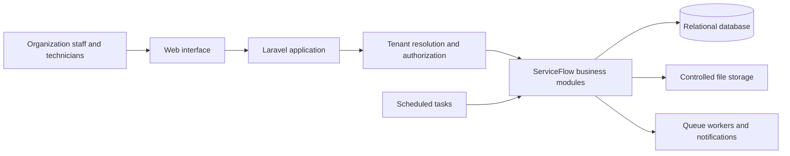

The planned application should centralize organization context and authorization, keep tenant-owned data scoped to the active organization, and use database transactions for critical multi-step operations. Infrastructure choices beyond the currently configured starter defaults remain open decisions.

## Main modules

The following modules are partially implemented in the organization-scoped admin panel unless noted otherwise.

1. **Organization and multi-tenancy**
   - Organization and branch records, tenant selection, and organization-scoped resources are implemented.
   - Organization onboarding and member management are planned.
2. **Authentication and access control**
   - Laravel authentication and organization role checks are implemented for the admin panel.
   - Invitations, member management, and fine-grained policies are planned.
3. **Customer management**
   - Customer profiles and service addresses have tenant-scoped CRUD; customer history remains planned.
4. **Equipment and asset management**
   - Equipment details, serial numbers, warranty dates, customer ownership, and location have tenant-scoped CRUD.
   - Integrated maintenance and repair history remains planned.
5. **Service requests**
   - Requests support creation, priority, status actions, and conversion to work orders.
   - Attachments, comments, and activity history remain planned.
6. **Work order management**
   - Work orders support assignment, scheduling, status transitions, completion notes, and work entries.
   - Photos and completion reports remain planned.
7. **Technician management**
   - Organization-scoped weekly availability, work assignment, and dashboard utilization are implemented.
   - Technician profile management and the mobile job interface remain planned.
8. **Preventive maintenance**
   - Maintenance contracts and upcoming maintenance schedules are implemented.
   - Automatic recurring work-order generation and contract renewal reminders remain planned.
9. **Estimates, invoices, and payments**
   - Estimate approval and invoice generation, invoice totals and sent-status tracking, payment recording, and outstanding balances are implemented. Email delivery is not yet configured.
   - Tax configuration is limited to a per-record rate; jurisdiction-specific tax handling remains planned.
10. **Notifications and reporting**
    - Email and configurable notification channels.
    - Overdue-job and upcoming-maintenance alerts, operational dashboards, and reports.
11. **SaaS subscription management**
    - Subscription plans, feature limits, organization billing, usage tracking, and subscription lifecycle management.

## Dashboard

The organization-scoped dashboard currently includes:

- KPI cards for open requests, active work orders, scheduled jobs, completed jobs, and outstanding payments.
- Service-request trends, work-order status distribution, and technician utilization calculated from saved weekly availability and scheduled work.
- Date and branch filters, an upcoming-work-order schedule, recent service requests, and upcoming maintenance.
- A quick action to create a tenant-owned service request.

The broader design direction also includes mobile technician workflows, additional reports, and organization-level user management.

## User roles and permissions

The role and membership foundation is implemented. `platform_admin` is assigned globally. `organization_owner`, `admin`, `dispatcher`, and `technician` are assigned per organization membership, and one user may have multiple memberships and roles. Active organization owners and admins, plus platform admins, can access the Filament panel; dispatchers and technicians cannot. Operational resources and their selection lists are scoped to the active organization, with database constraints protecting cross-organization references.

There is not yet a user or membership management screen. Initial user, organization, and owner membership setup must currently be done with an approved seeder or through Laravel Tinker. Avoid creating production users with shared or committed passwords.

The initial roles still need validation against the full organization workflows:

| Role | Scope and intended responsibility |
| --- | --- |
| `platform_admin` | Global platform-level administration |
| `organization_owner` | Manage one organization's settings, members, branches, and access |
| `admin` | Organization-level administration |
| `dispatcher` | Triage requests, assign work, and coordinate schedules |
| `technician` | View assigned work and record job progress and completion |

The new operational models and tables exist, but fine-grained permissions for dispatchers and technicians still need to be implemented before those roles receive panel access.

## Installation prerequisites

- PHP satisfying the repository's `^8.3` Composer requirement, with the extensions required by Laravel and the selected database driver.
- Composer.
- Node.js and npm compatible with the installed Vite toolchain.
- SQLite for the default local setup, or a reachable MySQL/MariaDB instance if using that configured connection.
- Redis only if you choose to use Redis-backed queues, cache, or other services; it is not required by the default `.env.example`.

## Local development setup

The following PowerShell commands use the repository's default SQLite configuration. `composer setup` is an existing project script that installs Composer and npm dependencies, creates `.env` if missing, generates an application key, runs migrations, and builds frontend assets.

```powershell
composer setup
composer run dev
```

`composer run dev` invokes the project's Artisan `dev` command. Alternatively, run the web server and Vite separately in two terminals:

```powershell
php artisan serve
```

```powershell
npm run dev
```

For a manual setup, useful when configuring MySQL before the first migration:

```powershell
composer install
if (!(Test-Path .env)) { Copy-Item .env.example .env }
php artisan key:generate
# Configure .env for the selected database before continuing.
php artisan migrate
npm install
npm run build
```

Generate `APP_KEY` for a new local environment only. Do not replace an existing key for an environment containing encrypted application data.

## Environment configuration

`.env.example` is the checked-in configuration template. Keep credentials and secrets in the untracked local `.env` or in your deployment platform's secret manager; do not commit them. Never copy real credentials into documentation or source control.

The template currently defaults to SQLite, database-backed sessions, database-backed cache, database-backed queues, and log-based mail. For a local MySQL setup, create an empty database and set the corresponding values in `.env` before migrating:

```dotenv
APP_NAME=ServiceFlow
APP_ENV=local
APP_DEBUG=true
APP_URL=http://localhost:8000

DB_CONNECTION=mysql
DB_HOST=127.0.0.1
DB_PORT=3306
DB_DATABASE=<local_database_name>
DB_USERNAME=<local_database_user>
DB_PASSWORD=<local_database_password>
```

Keep `APP_KEY` generated by `php artisan key:generate`. Configure production values, mail transport, storage, queue/cache backend, and debug settings independently for each environment. Do not use `APP_DEBUG=true` in production.

## Database setup and migrations

The configured default is SQLite at `database/database.sqlite`. Migrations create framework tables, organization and membership records, and the tenant-owned ServiceFlow operational and financial tables.

After configuring the database:

```powershell
php artisan migrate
php artisan migrate:status
```

The `DatabaseSeeder` calls `RoleUserSeeder`, provisioning the `ServiceFlow HQ` organization and all 8 pre-configured role accounts (`superadmin@example.com`, `admin@example.com`, `technician@example.com`, etc., with default password `12345678`). Run `php artisan db:seed` to seed or reset these records.

## Running the application and frontend assets

Frontend entry points are `resources/css/app.css` and `resources/js/app.js`. The Filament admin panel provides the current operational interface. Tailwind CSS is integrated through Vite. Use:

```powershell
npm run dev
```

for local asset development, or:

```powershell
npm run build
```

to build assets.

## Queues, scheduled tasks, and tests

The `.env.example` configures the database queue. The starter includes the queue tables, but it has no ServiceFlow jobs or notifications yet. To run a worker when queue jobs are added:

```powershell
php artisan queue:work
```

Laravel's scheduler is available, but no project-specific scheduled tasks are currently defined. When scheduled work is introduced, run it locally with:

```powershell
php artisan schedule:work
```

Run the existing tests with:

```powershell
php artisan test
```

The current suite covers starter behavior and the initial tenant foundation, not ServiceFlow business workflows. The Composer `test` script additionally runs the configured Pint check and Larastan analysis before the Artisan test suite.

## Security and multi-tenancy principles

These principles apply as product features are added. The current foundation enforces organization-scoped membership roles and prevents cross-organization branch assignments, but no business-record queries or resources exist yet.

- Resolve the active organization centrally and authorize each action against its membership and role.
- Scope every organization-owned query and mutation to the authorized tenant; test cross-tenant access boundaries.
- Validate input and enforce authorization on the server for every state-changing operation.
- Use database transactions for critical business operations that update related records.
- Validate uploads, restrict file access, and avoid publicly exposing private customer or job attachments.
- Queue notifications with retry and failure handling where appropriate.
- Record audit trails for important business actions.
- Add automated tests for tenant boundaries and critical customer, request, work-order, and billing workflows.
- Keep configuration environment-based, secrets out of source control, and production debug output disabled.
- Plan structured logging, backups, monitoring, and deployment/recovery procedures before production use.
- Choose tenancy, authorization, API, and real-time packages only after validating requirements; no dedicated tenancy package is currently installed or selected.

## Development roadmap

The remaining product work is planned. Phase 1 is in progress; the foundation is not completion of the authentication, onboarding, and authorization workflows.

| Phase | Planned scope | Status |
| --- | --- | --- |
| 1 | Laravel setup, authentication, organization onboarding, roles, tenant isolation, and base Filament dashboard | In progress; organization, branch, membership, role, and panel-access foundations are implemented |
| 2 | Customers, service addresses, equipment, and assets | Planned |
| 3 | Service requests, work orders, assignments, and technician workflows | Planned |
| 4 | Scheduling, estimates, invoices, and payment records | Planned |
| 5 | Preventive maintenance, contracts, and recurring work orders | Planned |
| 6 | Notifications, reports, subscriptions, testing, security hardening, and production deployment | Planned |

## Contribution guidelines

Contributions should preserve the distinction between implemented functionality and roadmap intent. Before opening a change:

1. Review the existing Laravel and frontend conventions and keep changes focused.
2. Include or update automated tests for behavior changes, especially authorization and tenant isolation.
3. Run the relevant tests and quality checks (`composer test` for the configured full project checks).
4. Document new setup requirements and configuration without committing secrets.
5. Do not describe a planned capability as implemented until it is present and verified.

## License

The Composer project metadata declares the project as **MIT licensed**. A root `LICENSE` file is not currently present; add and maintain the appropriate license text before distributing the project.
